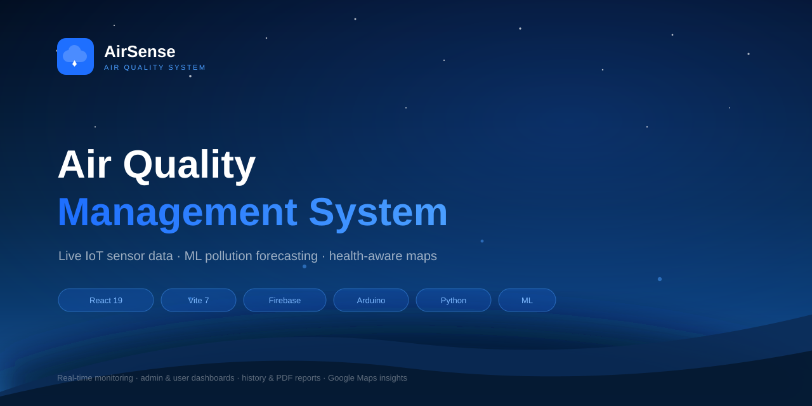
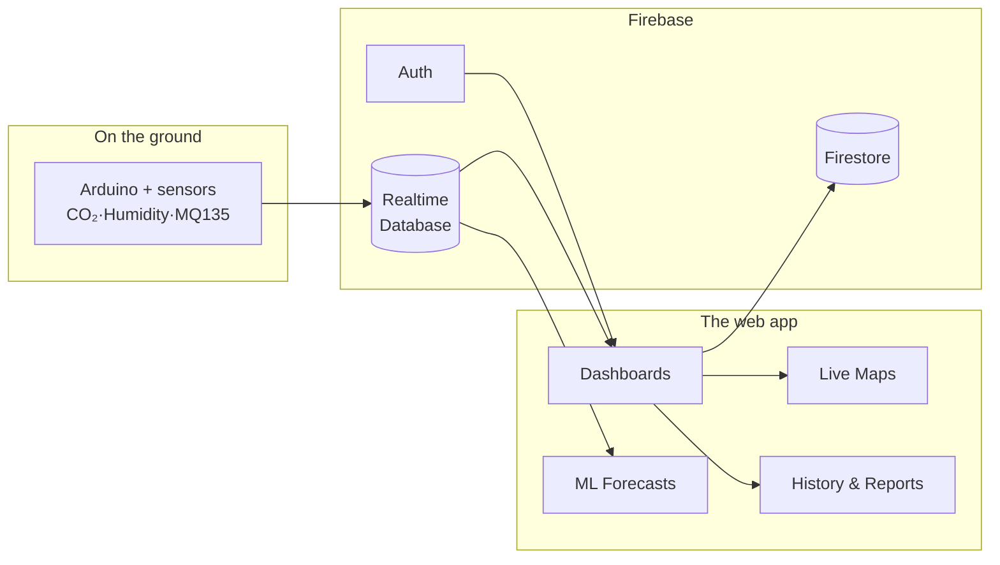

<p align="center">
  <a href="https://haseeb35.github.io/Air-Quality-Management-System-/">
    
  </a>
  <a href="#-try-it-live">
    
  </a>
  <a href="LICENSE">
    
  </a>
</p>

<b>The internet of things meeting the air we breathe.</b> This is a full-stack IoT and AI-powered air quality monitoring platform — real-time sensor telemetry, machine-learning pollution forecasts, and location-based health insights, all in one dashboard.

---

## 🚀 Try It Live

Open the live preview and hit **Demo Login** — no typing needed. It signs you straight into the admin dashboard.

| Field | Value |
|-------|-------|
| **Email** | `demo@airsense.com` |
| **Password** | `Demo@2026` |
| **Role** | Admin (full view) |

Or type those in yourself, or press **Sign Up** to create your own account.
> Google sign-in only works once the deployment domain is whitelisted in Firebase → Authentication → Settings → Authorized domains.

---

## ✨ Features

| Real-time Monitoring | ML Forecasting | Health-aware Maps |
|:--:|:--:|:--:|
| Live CO₂, humidity & MQ135 feeds straight off Arduino sensors | ML models that predict pollution trends before they happen | Pinned sensor clusters with risk zones on Google Maps |

| Admin & User dashboards | User management | History & reports |
|:--:|:--:|:--:|
| Role-based command centers for both worlds | Register, view, edit & delete accounts | Charts, Excel exports and PDF reports |

---

## 🏗 How it connects



---

## 🧰 Tech stack

| Layer | Tools |
|-------|-------|
| **Frontend** | React 19 · Vite 7 · Bootstrap · Chart.js · Recharts |
| **Backend** | Firebase Auth · Firestore · Realtime Database |
| **Maps** | @react-google-maps/api |
| **Reporting** | jsPDF · xlsx |
| **Device** | Arduino firmware |
| **Data pipeline** | Python scripts |

---

## 🛠 Getting started

```bash
npm install      # install dependencies
npm run dev      # start the dev server
npm run build    # production build
npm run lint     # lint
```

### Firebase setup
1. Create a Firebase project and enable **Authentication**, **Firestore** and **Realtime Database**.
2. Drop your config into `src/firebase.js`.
3. Add any secrets to `.env` (see `.env.example`).

---

## 📁 Project structure

```
src/
├── App.jsx                  # routing hub
├── main.jsx                 # entry point
├── firebase.js              # Firebase config
├── SignIn.jsx / SignUp.jsx  # auth screens
├── AdminDashboard.jsx       # admin panel
├── UserDashboard.jsx        # user panel
└── components/
    ├── SensorData.jsx       # live sensor readings
    ├── Predictions.jsx      # ML pollution forecasts
    ├── MapScreen.jsx        # location-based insights
    ├── HistoryScreen.jsx    # historical data
    └── ...                  # nav, sidebar, user management
```

---

## 📦 What's inside

- `Source-Code.zip.zip` — full source archive
- `Adruino latest Code.zip` — IoT device firmware
- `Python Code.zip` — data collection & prediction scripts
- PDFs — project document, poster & user manual

---

## 📜 License

MIT © 2026